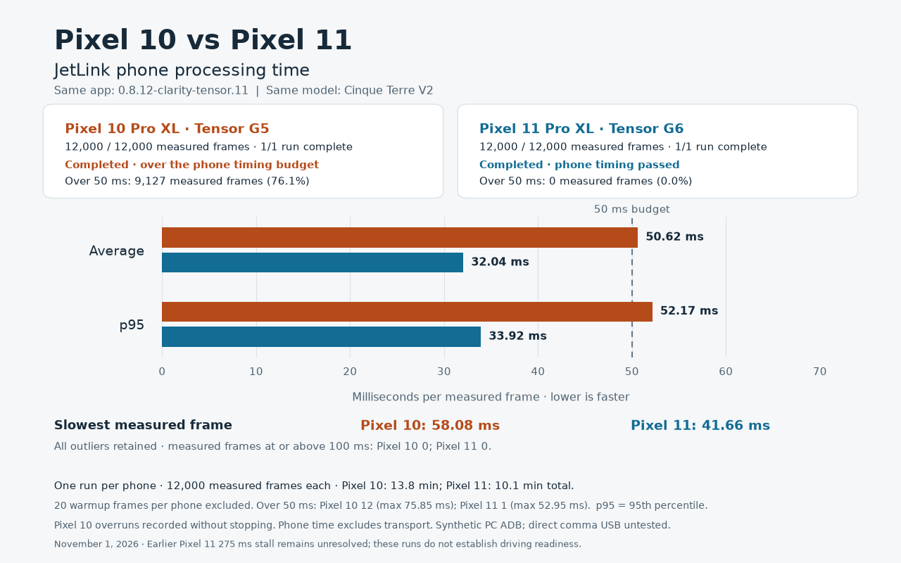

# Pixel 10 Pro XL JetLink tests — November 1, 2026

The Pixel 10 Pro XL received a fresh installation of **`0.8.12-clarity-tensor.11`**, the same APK used on the Pixel 11 Pro XL, with a Tensor G5 compilation of Cinque Terre V2. It completed the requested **12,000-frame timing-record run**, averaging **50.625 ms** of phone processing, with p95 **52.165 ms** and maximum **58.077 ms**. **9,127 measured frames exceeded 50 ms**, so completing the measurement did not pass timing qualification. [Sanitized results](../android/tensor/pixel10-tests-2026-11-01.json).

Numerical checks passed. Both initial strict attempts stopped after 100 measured frames because their 100-frame p95 exceeded 50 ms. At the user's request, the subsequent full run recorded those exceedances while continuing. The user then requested stopping after that first full run; a second full run was not started. App/model settings, timing qualification and thermal stops remain unchanged.

## Setup and model identity

The [complete Pixel 10 compilation guide](../android/tensor/PIXEL10_COMPILE.md) gives the pinned source download, converter and compiler commands, model import, fresh-cache preparation and validation procedure.

| Item | Value |
| --- | --- |
| Phone / chipset | Pixel 10 Pro XL / Tensor G5 |
| App / version code | `0.8.12-clarity-tensor.11` / `81211` |
| APK SHA-256 | `30880b942fbc44b8d09f4c54ba25321e60df7f5c0dce235d50b8e74f6f9e6f3e` |
| Processor | Tensor TPU (precompiled) |
| Runtime | LiteRT 2.3.0 |
| Model | Cinque Terre V2 |
| Source ONNX SHA-256 | `09d080f36965bb2a0790500452bd328aa03c484d0222aa79d1ad9f021a522aec` |
| Compiled G5 SHA-256 | `9a4481fde9229db6362778c218eae8b28e97774e46d73ad2358ff91bde823ca2` |
| Compiled bytes | `777647632` |
| Compiler settings | Tensor SDK 2.1, `Tensor_G5`, `half`, `minimal` |

For reuse, follow the [APK installation instructions](../android/README.md#install-or-update) and [Tensor model import procedure](../android/tensor/README.md#import-into-the-pixel). The Pixel 10 import must target **Tensor_G5**, with its [matching manifest](../android/tensor/validated-model-g5.json) and LiteRT 2.3.0 runtime. Select **Tensor TPU (precompiled)** and verify the source and compiled hashes before testing. The private SDK and model weights are not redistributed here.

No model precision, timing qualification threshold or thermal limit was relaxed. The later measurement-only timing mode is described below. V3 was not promoted or qualified by this work.

## Numerical checks

All 160 captured full-output frames contained the expected 18,452 finite values. The first 32 outputs matched the prior G5 installation exactly, with zero maximum absolute difference; all 64 corresponding input arrays also matched. The unchanged 32-frame reference comparison passed all 15 output slices, including its per-frame and pooled checks.

The two timing attempts also produced identical output hashes across their 120 corresponding frames, including warmup. This is repeatability evidence, not an additional reference-accuracy comparison. A 160-frame finite-output check does not extend the 32-frame reference result to every later frame.

## Initial strict timing attempts

Each attempt requested 20 warmup frames followed by 12,000 measured frames at a 50 ms interval. The tests used PC ADB/TCP forwarding over USB, with 30 seconds of rest between attempts. Synthetic inputs cycled through 32 frames with recurrent state continuing after a reset at frame zero.

The unchanged guard stops at a measured phone-processing time of 100 ms or a 100-frame phone-processing p95 of 50 ms. Health checks also stop at battery temperature 43°C, Android severe thermal status (3), or missing/invalid/stale telemetry.

Times below are milliseconds unless stated otherwise. Measured statistics exclude warmup.

| Metric | Attempt 1 | Attempt 2 |
| --- | ---: | ---: |
| Measured frames / requested | 100 / 12,000 | 100 / 12,000 |
| Measured duration, seconds | 6.906 | 6.739 |
| Phone processing mean | 50.163 | 50.167 |
| Phone processing p95 | 51.185 | 51.076 |
| Phone processing maximum | 55.744 | 56.057 |
| Measured phone frames over 50 ms | 56 | 65 |
| Warmup phone maximum | 77.556 | 85.554 |
| Warmup phone frames over 50 ms | 12 / 20 | 12 / 20 |
| PC round-trip p95 | 77.102 | 73.379 |
| PC round-trip maximum | 90.183 | 93.392 |
| Battery temperature before → after, °C | 25.8 → 25.8 | 26.1 → 26.1 |
| Highest recorded Android thermal status | 0 (normal) | 0 (normal) |
| Outcome | Stopped at first 100-frame p95 guard | Stopped at first 100-frame p95 guard |

Aggregate timings, warmup counts and the triggering 100-frame blocks were independently recomputed from per-frame captures. Both phone and PC round-trip timing checks failed. The harness marks an incomplete run as `protocol_pass: false`; the recorded stop reason was the timing guard, not a separate wire-protocol error.

## Full-duration follow-up

The host harness's optional `--record-timing-overruns` mode continues measuring after timing exceedances. Its default mode still stops at the same timing guards, and the timing qualification thresholds are unchanged. Missing/invalid/stale telemetry, thermal limits, inference failures and non-finite outputs remain reasons to stop. Nine host-side health and timing regression tests passed after this reporting option was added; the installed APK and model were unchanged.

| Full-run metric | Result |
| --- | ---: |
| Measured frames / requested | 12,000 / 12,000 |
| Measured duration | 825.756 s (13 min 45.8 s) |
| Achieved measured rate | 14.532 Hz |
| Phone processing mean / p95 / p99 | 50.625 / 52.165 / 56.067 ms |
| Phone processing maximum | 58.077 ms |
| Measured phone frames over 50 ms | 9,127 / 12,000 (76.1%) |
| Measured phone frames at or over 100 ms | 0 |
| Warmup phone maximum / frames over 50 ms | 75.846 ms / 12 of 20 |
| PC round-trip mean / p95 / maximum | 68.726 / 78.187 / 107.985 ms |
| PC round trips over 50 ms | 12,000 / 12,000 |
| Battery temperature before → after | 27.0 → 34.4°C |
| Highest recorded Android thermal status | 0 (normal) |
| Inference/non-finite/health failures | 0 |
| Phone / PC round-trip timing qualification | Failed / Failed |

All 120 measured 100-frame blocks exceeded the phone p95 limit; all 120 timing events are retained. P95 across the ten 1,200-frame blocks ranged from 51.674 to 55.290 ms. All measured outputs were finite. Raw-frame distributions, block statistics and timing events were independently recomputed. Only one full run was completed, so repeatability between full runs was not tested.

## Comparison with Pixel 11 Pro XL

The comparison uses **one completed 12,000-frame run per phone**: the Pixel 10's full timing-record run and the first [Pixel 11 long run](PIXEL_LONG_TESTS_2026-11-01.md). Both used the same APK and source V2 model, with a compilation for their respective chipsets. The initial short Pixel 10 attempts are excluded from these averages.

| Measured phone processing | Pixel 10 Pro XL | Pixel 11 Pro XL |
| --- | ---: | ---: |
| Mean | 50.625 ms | 32.042 ms |
| P95 | 52.165 ms | 33.922 ms |
| Maximum | 58.077 ms | 41.662 ms |
| Frames over 50 ms | 9,127 / 12,000 | 0 / 12,000 |

Frame counts match, but wall time differs because the Pixel 10's full ADB exchanges were slower. The requested interval was 50 ms; the measured rates were 14.532 Hz and 19.890 Hz respectively. Warmup is excluded from this table and remains recorded separately. Both devices failed the PC round-trip timing check. The Pixel 11's earlier unexplained 275.406 ms stall remains unresolved. Neither device's desk results establish direct comma USB reliability or driving readiness.

[PNG](images/pixel-comparison-2026-11-01/pixel-jetlink-comparison.png) · [SVG](images/pixel-comparison-2026-11-01/pixel-jetlink-comparison.svg) · [Copyable summary](images/pixel-comparison-2026-11-01/pixel-jetlink-comparison.txt)

## Handoff

The installed APK and compiled G5 model hashes were checked on the phone, and its matching manifest was verified. It was left at **Waiting for Comma · Cinque Terre Model V2**, using **Tensor TPU (precompiled)**, with no test load running.

The temporary Developer listener was disabled and checked after an app restart. Owned ADB forwarding, the temporary phone UI file and the temporary phone screenshot were removed. At handoff the battery was 33.5°C with normal Android thermal status (0), USB power connected and no wireless power reported.

The comma was not contacted or reconfigured, no connection window was armed, and no new direct comma USB or driving test was performed. Completing the diagnostic measurement does not change the failed timing qualification or promote V3.
